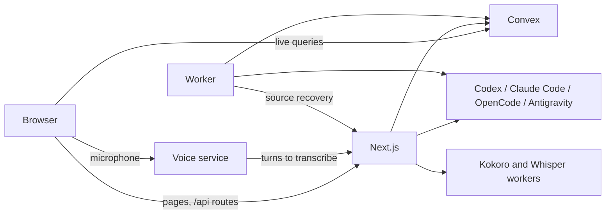

# Architecture

Blitz is a Next.js app with a local Convex database and a background worker, all running on one computer. Models run through the coding agents already installed and signed in there (Codex, Claude Code, OpenCode or Antigravity), never through an API key Blitz holds. A phone or another browser is only a client of that computer.

## Processes

One supervisor (`electron/service-manager.mjs`) starts and watches four services, restarting any that exits or stops answering:

| Service | What it does | Code |
| --- | --- | --- |
| Next.js | Pages and `/api` routes: uploads, Teach and chat turns, answers, audio | `app/` |
| Convex | The local database: every project, source, passage, chat and answer | `convex/`, data in `.convex/local/default` |
| Voice | WebSocket service that streams the microphone and finds turn boundaries | `scripts/voice-service.ts` |
| Worker | Background loops (below) | `scripts/worker.ts` |

Kokoro and Whisper run as Python workers that Next starts on demand and stops when idle (see [local speech](local-kokoro.md)).

The same supervisor runs under three launchers:

- **The background server** (`npm run server -- install`, macOS and Linux) serves the newest `main` on port 3007 and updates itself. See [local server](local-server.md).
- **The desktop app** opens whichever Blitz is already serving, or runs its own copy on 3008. See [local desktop host](local-desktop-host.md).
- **`npm run dev`** runs `next dev` from the checkout, on 3009 if another copy is already serving the database. `npm run dev:lan` runs a production build instead.

## The background worker

`scripts/worker.ts` is one Node process with three loops, each run through `runWorkerLoop` (`lib/server/worker-loop.ts`), so a failing step is logged and retried with backoff (3 seconds, doubling up to 30) without stopping the others:

- **`ingestion`** finishes uploads interrupted by a restart by calling `/api/sources/retry`.
- **`research`** plans [Find sources](research.md) proposals and imports approved sources.
- **`threads`** gives the Codex and Claude Code threads behind chats their titles, and deletes the threads of deleted chats (`lib/server/runtime-threads.ts`).

`--only ingestion|research|threads` runs one loop and `--once` runs a single pass. The worker reads `.env.local` and reaches Convex through `BLITZ_CONVEX_URL`.

## Code layout

- `app/` holds routes, layouts and `/api` handlers.
- `components/` holds feature components; shared shadcn components are in `components/ui/`.
- `convex/` holds the schema (`convex/schema.ts`), queries and mutations.
- `lib/` holds plain logic shared by server, browser and tests. `lib/server/` is server-only (providers, extraction, speech), `lib/client/` is browser-only, and `lib/learning/` is the learning core.
- `electron/` holds the desktop shell, supervisor and updater; `scripts/` holds launchers, the worker, the voice service and Python speech workers.
- `mcp/` is an MCP server for other agents; see [its README](../mcp/README.md).
- `tests/` holds the Node test suite (`npm test`), which uses fixtures and a fake engine (`tests/fixtures/fake-engine.ts`), so it needs no database or provider sign-in.

## Data model

`convex/schema.ts` is the source of truth. The main tables:

| Area | Tables |
| --- | --- |
| Modules | `projects` (a module), `units` (a week or lecture) |
| Sources | `sources`, `ingestionJobs`, `sourceChunks` (passages), `sourceOutlines`, `preparationJobs` |
| Learning | `concepts`, `learningItems`, `conceptReviews`, `studyEvents`, `learningActivity`, `questionGenerations`, `writingActivities` |
| Exams | `examPapers`, `examAttempts` |
| Chat and Teach | `workspaceChats` (Teach sessions too), `workspaceChatMessages`, `workspaceChatAttachments`, `chatDocuments`, `runtimeThreadJobs` |
| Research | `researchProposals`, `researchProposalImports` |
| Project agents | `agentTasks`, `artifacts` |
| Settings | `aiModelSettings`, `spendingLimits`, `studyPreferences`, `audioVoiceSettings` |

`topics` is left from the first learning feed; nothing writes to it now. Original files live on disk in each project's folder, not in Convex (see [local desktop host](local-desktop-host.md#project-folders)).
